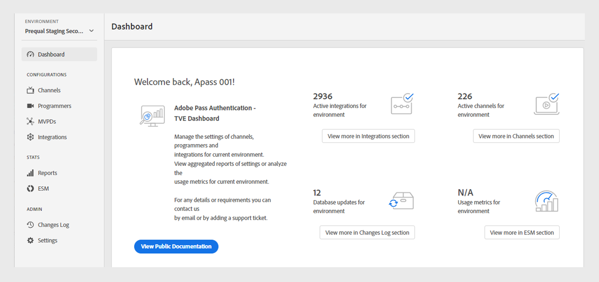
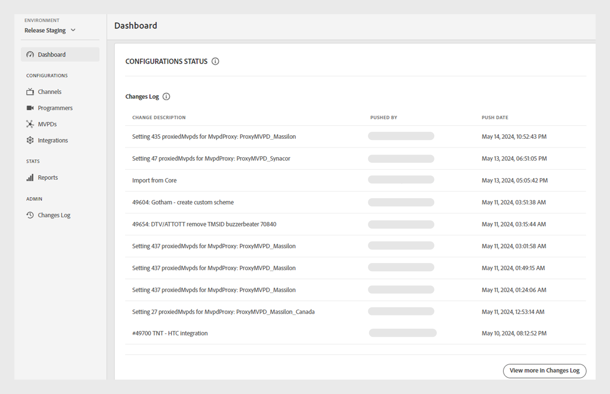

# Dashboard {#dashboard}

>[!NOTE]
>
>Der Inhalt dieser Seite dient nur zu Informationszwecken. Die Verwendung dieser API erfordert eine aktuelle Lizenz von Adobe. Eine unbefugte Nutzung ist nicht zulässig.

Der **Dashboard** im linken Bereich dient als Startseite des TVE-Dashboards zur Adobe Pass-Authentifizierung.

Auf der Homepage stehen zwei Bereiche zur Verfügung:

* [Begrüßungsbildschirm](#welcome-screen)
* [Konfigurationsstatus](#configuration-status)

## Begrüßungsbildschirm {#welcome}

In diesem Abschnitt können Sie direkt über die Begrüßungsnachricht auf die öffentliche Dokumentation zugreifen und einen Schnappschuss Ihrer aktuellen Konfigurationen anzeigen.

* **Aktive**: Die Anzahl der aktiven Integrationen in der aktuellen Umgebung. Wählen Sie **Weitere Informationen im Abschnitt Integration anzeigen**, um auf detaillierte Informationen im Abschnitt [Integrationen](tve-dashboard-integrations.md) zuzugreifen.
* **Aktive**: Die Anzahl der aktiven Kanäle in der aktuellen Umgebung. Wählen Sie **Weitere Informationen im Abschnitt Kanäle anzeigen** aus, um auf detaillierte Informationen im Abschnitt [Kanäle](tve-dashboard-channels.md) zuzugreifen.
* **Datenbankaktualisierungen**: Die Anzahl der Konfigurationsänderungen, die an der aktuellen Umgebung vorgenommen wurden. Wählen Sie **Weitere Informationen im Abschnitt Änderungsprotokoll anzeigen**, um auf detaillierte Informationen im Abschnitt [Änderungsprotokoll“ ](tve-dashboard-changes-log.md).
* **ESM-Dashboard**: Sehen Sie im Auge nach dem kommenden ESM-Dashboard, das detaillierte Metriken zur Eigenschaftsnutzung in der aktuellen Umgebung bietet. Diese Funktion wird in zukünftigen Updates verfügbar sein.

*Begrüßungsbildschirm*

## Konfigurationsstatus {#conf-status}

In diesem Abschnitt werden die 10 jüngsten Konfigurationsänderungen vorgestellt, darunter:

* **Änderungsbeschreibung**: Eine kurze Beschreibung der vom Benutzer ausgewählten Änderung.
* **Push von**: Das für die Änderung verantwortliche Konto.
* **Push-**: Das Datum, an dem die Änderung vorgenommen wurde.

*Konfigurationsstatus eines Änderungsprotokolls*

Um die vollständige Liste der Änderungen anzuzeigen, wählen Sie **Weitere Informationen im Änderungsprotokoll anzeigen** unten rechts aus, um den Abschnitt [Änderungsprotokoll“ ](tve-dashboard-changes-log.md).
