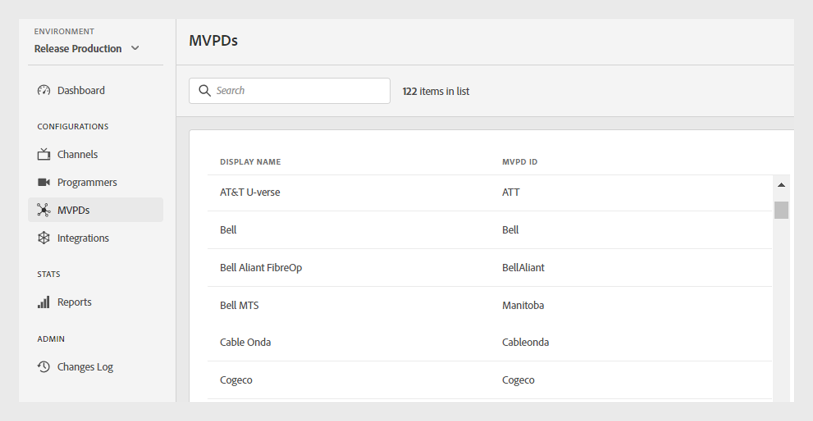

# MVPD

>[!NOTE]
>
>Der Inhalt dieser Seite dient nur zu Informationszwecken. Die Verwendung dieser API erfordert eine aktuelle Lizenz von Adobe. Eine unbefugte Nutzung ist nicht zulässig.

Im **MVPDs** des TVE-Dashboards können Sie eine Liste der integrierten MVPDs im Authentifizierungs-Ökosystem von Adobe Pass anzeigen.

Auf der Registerkarte **MVPDs** im linken Bereich wird eine Liste von MVPDs mit den folgenden Details angezeigt:

* **Anzeigename**: Der Anzeigename in der Auswahl für jede MVPD.

* **MVPD ID**: Eine eindeutige ID von MVPD, die zum Einrichten einer neuen Integration im System verwendet wird.

*Liste der integrierten MVPDs*

Geben Sie den Namen einer MVPD in der Leiste **Suche** über der Liste ein, um eine bestimmte MVPD zu finden.
