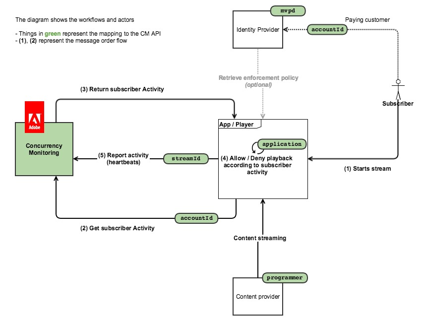
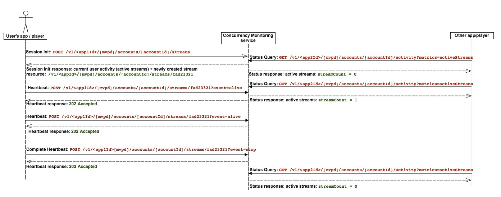

# Informationspunkt für Richtlinien {#pip}

>[!NOTE]
>
>Diese Seite ist veraltet, da sie für die vorherige Version der API gilt, die für neue Integrationen nicht mehr empfohlen wird

Das folgende Diagramm zeigt den Ablauf für den Fall, dass der Kunde sich für den **Policy Information Point** entscheidet. In diesem Fall wird CM nur für die Abfrage der Aktivität verwendet und die gesamte Zugriffslogik ist in die Client-Anwendung eingebettet):

Das folgende Diagramm zeigt, wie die Stream-Zählung für einen Benutzer funktioniert, der Inhalte von zwei Geräten aus überwacht.

Kurz gesagt, der übliche Nachrichtenfluss sieht wie folgt aus:

1. Zunächst wird für einen Benutzer, der den Service nie verwendet hat, eine Web-Seite geladen/eine Anwendung wird geöffnet, bei der eine instrumentierte Anwendung des Services für die gleichzeitige Überwachung einen Sitzungsinitialisierungsaufruf ausführt.
1. Der Dienst zur Überwachung gleichzeitiger Zugriffe gibt die neue Stream-Ressource für Heartbeats sowie die aktuelle Benutzeraktivität zurück.
1. Während der Videowiedergabe führt die instrumentierte Anwendung Heartbeat-Aufrufe an den Parallelitätsüberwachungs-Service durch und zeigt an, dass der Benutzer derzeit ein Video verwendet.
1. Zu jedem anderen Zeitpunkt können andere instrumentierte Anwendungen Statusabfrageaufrufe an den Parallelitätsüberwachungs-Service durchführen, der die aktuelle Benutzeraktivität zurückgibt.
1. Am Ende der Videowiedergabe kann die instrumentierte Anwendung einen Heartbeat-Aufruf mit „event=stop“ ausführen, was bedeutet, dass das Video angehalten wurde und der aktuelle Stream nicht mehr als aktiver Stream gezählt werden sollte.
